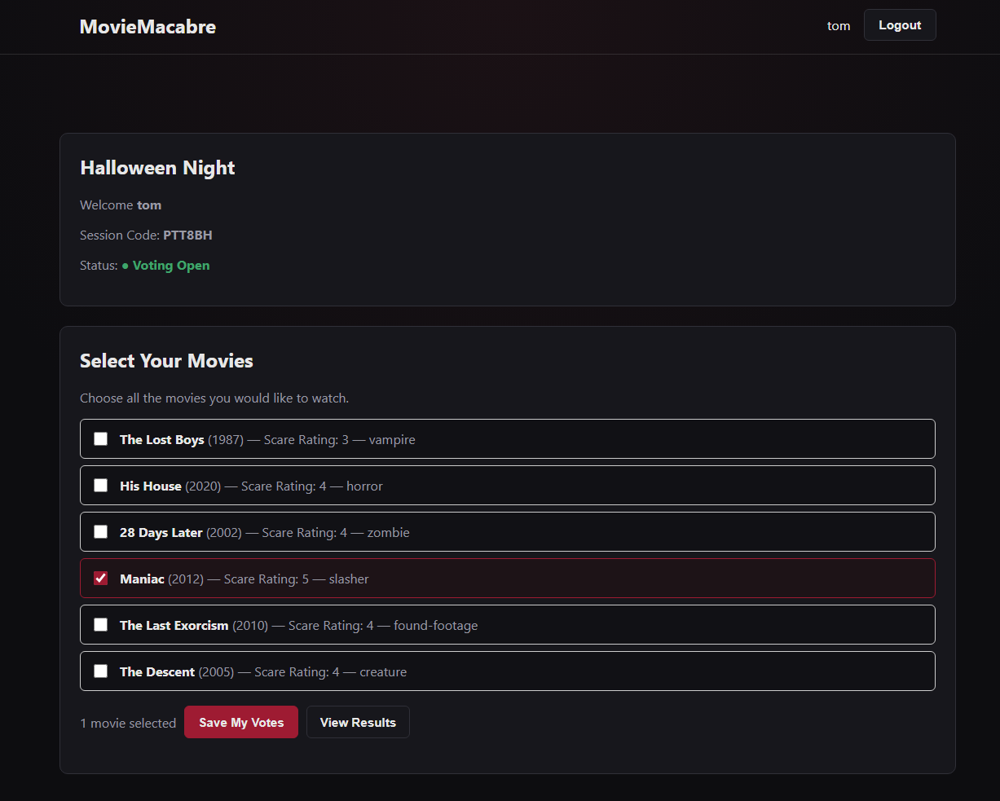
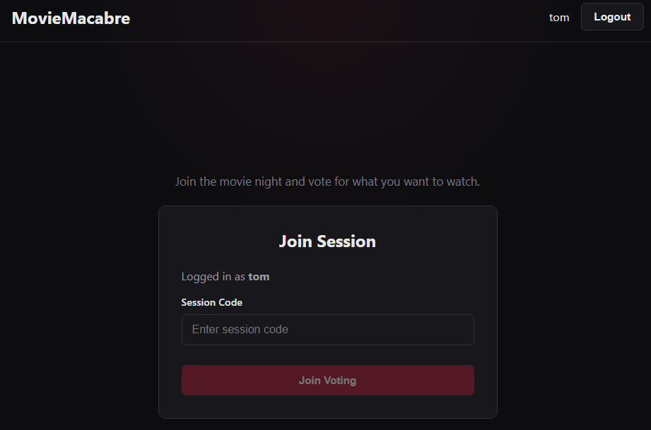
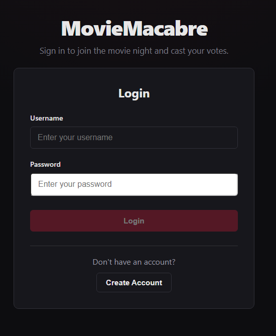
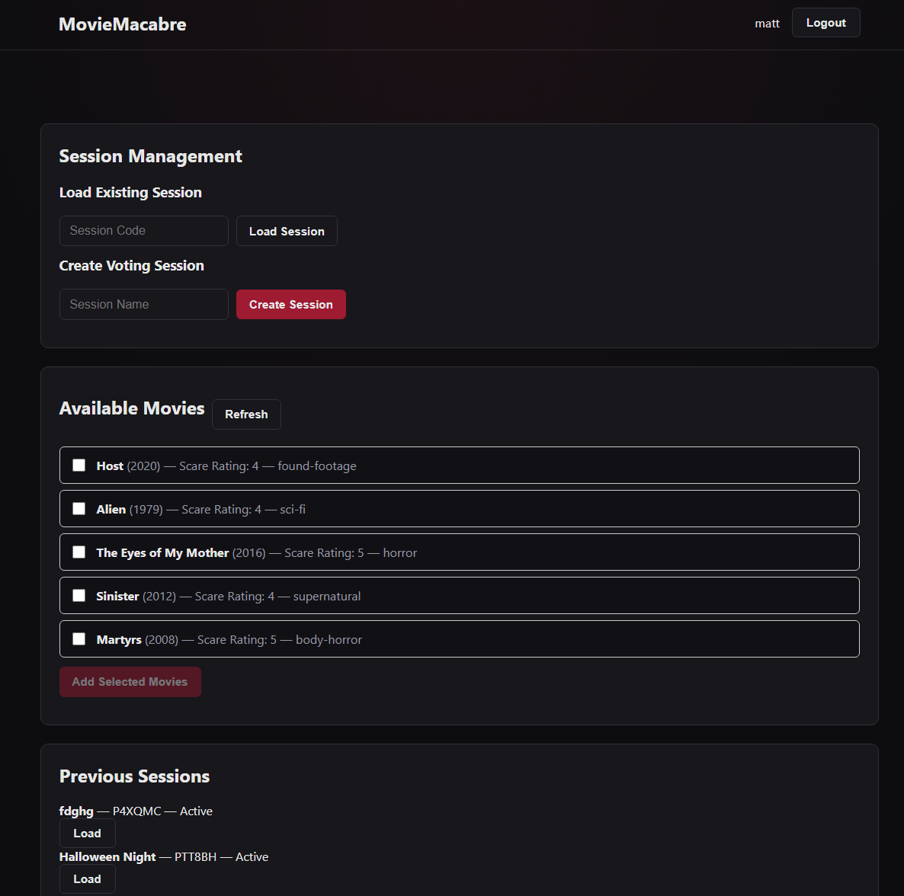
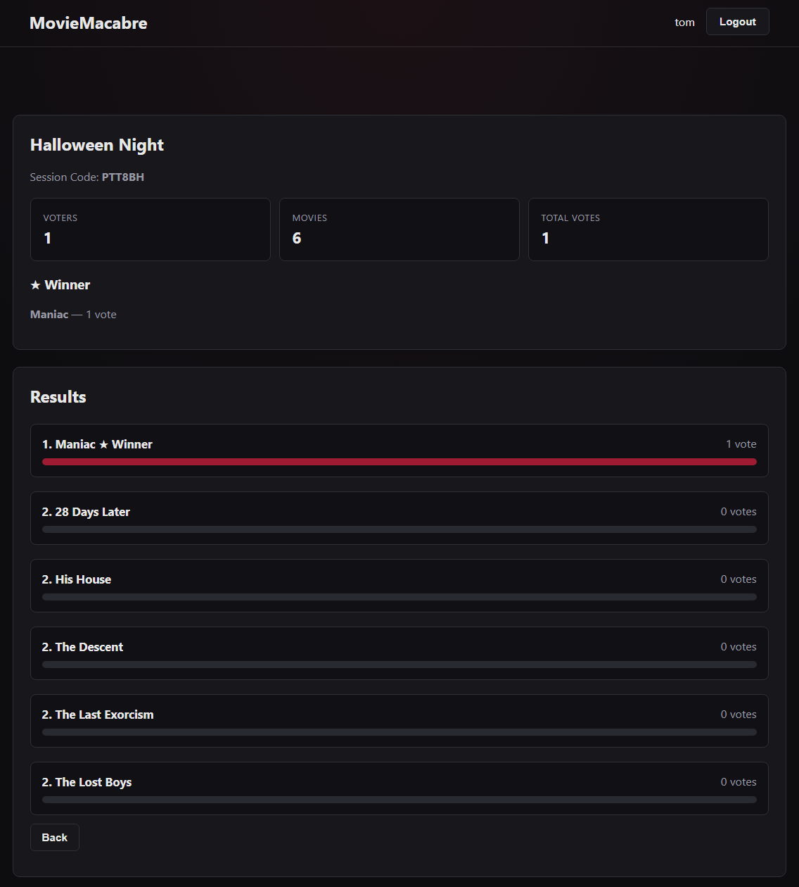

# 🎬 MovieMacabre

**A collaborative horror movie voting application built with React, FastAPI, Docker, and AWS.**

MovieMacabre helps groups decide what horror movie to watch. An administrator can create a movie night, generate a randomized selection of horror films, and invite participants to vote for their favorites.

The project also demonstrates full-stack development, infrastructure as code, containerization, and automated cloud deployment.

**Live Application:** [movie-macabre.com](https://movie-macabre.com)




## Features

### 🎥 Movie Night Management

- Create and manage movie voting sessions
- Generate randomized horror movie selections
- Organize movies by horror subgenre and scare rating
- Add or remove movies from a session
- Open and close voting sessions

### 🗳️ Collaborative Voting

- Join movie nights using a session code
- Browse and select preferred movies
- Submit and update votes
- View voting results

### 🔐 Authentication and Administration

- User registration and authentication
- JWT-based authentication
- Role-based authorization for administrative operations
- Protected frontend routes


<h2>Application Screenshots</h2>

<table>
  <tr>
    <td width="50%">
      
      <p align="center"><b>Join Session</b></p>
    </td>
    <td width="50%">
      
      <p align="center"><b>Movie Voting</b></p>
    </td>
  </tr>
  <tr>
    <td width="50%">
      
      <p align="center"><b>Admin Dashboard</b></p>
    </td>
    <td width="50%">
      
      <p align="center"><b>Voting Results</b></p>
    </td>
  </tr>
</table>


## Technology Stack

| Category | Technologies |
|---|---|
| Frontend | React, TypeScript, Vite |
| Backend | Python, FastAPI |
| Database | SQLite, SQLAlchemy |
| Database Migrations | Alembic |
| Authentication | JWT |
| Containerization | Docker, Docker Compose |
| Infrastructure | AWS EC2, Terraform |
| Configuration Management | Ansible |
| CI/CD | GitHub Actions |
| Cloud Management | AWS Systems Manager |
| Reverse Proxy | Caddy, Nginx |

## Application Architecture

MovieMacabre runs as a containerized application hosted on AWS EC2.

The application consists of three Docker Compose services:

- **Frontend:** React and TypeScript application served by Nginx
- **Backend:** FastAPI REST API responsible for authentication, movie management, voting, and results
- **Reverse Proxy:** Caddy handles incoming HTTP/HTTPS requests and routes traffic to the appropriate service

### Request Flow

```text
                     Users
                       |
                    HTTPS
                       |
                       v
                Caddy Reverse Proxy
                 movie-macabre.com
                       |
             +---------+---------+
             |                   |
             v                   v
         Frontend              Backend
       React / Nginx           FastAPI
             |                   |
             |                   v
             |                 SQLite
             |               movies.db
             |
             +---- API requests ----> Backend
```

### API Routing

Caddy provides a single public entry point for the application.

| Public Endpoint | Destination |
|---|---|
| `/` | Frontend Nginx container |
| `/api/health` | FastAPI `/health` |
| `/api/movies` | FastAPI `/movies` |
| `/api/sessions` | FastAPI `/sessions` |

Caddy removes the `/api` prefix before forwarding API requests to the backend.

HTTPS certificate management is handled by Caddy.

## Infrastructure and Deployment

MovieMacabre uses an automated deployment workflow built around AWS and GitHub Actions.

### Infrastructure as Code

**Terraform** defines and manages AWS infrastructure, including networking, compute resources, security configuration, and IAM permissions.

**Ansible** handles server configuration and application deployment tasks.

### Continuous Deployment

GitHub Actions automates deployment from the `main` branch.

The deployment process integrates several technologies:

1. GitHub Actions starts the deployment workflow.
2. GitHub authenticates to AWS using OpenID Connect (OIDC).
3. AWS IAM controls the permissions granted to the workflow.
4. AWS Systems Manager executes remote deployment commands.
5. Docker Compose manages the application containers.
6. Deployment health checks help verify application availability.

This approach reduces manual deployment work and avoids storing long-lived AWS access keys in GitHub.

## Project Structure

```text
MovieMacabre/
├── .github/
│   └── workflows/
│       └── deploy.yml
├── alembic/               # Database migrations
├── ansible/               # Server configuration and deployment
├── backend/
│   ├── app/
│   │   ├── routes/        # REST API endpoints
│   │   ├── services/      # Business logic
│   │   ├── models.py      # SQLAlchemy models
│   │   ├── schemas.py     # Pydantic schemas
│   │   └── security.py    # Authentication and security
│   ├── Dockerfile
│   └── requirements.txt
├── data/                  # Movie datasets and import scripts
├── frontend/
│   ├── src/
│   │   ├── components/
│   │   ├── pages/
│   │   ├── services/
│   │   └── types/
│   └── Dockerfile
├── scripts/               # Operational scripts
├── terraform/             # AWS infrastructure as code
├── tests/                 # Automated tests
├── Caddyfile
├── docker-compose.yml
└── README.md
```

## Local Development

### Prerequisites

- Git
- Docker
- Docker Compose

### 1. Clone the Repository

```bash
git clone <REPOSITORY_URL>
cd MovieMacabre
```

### 2. Configure Environment Variables

Create a `.env` file in the project root.

The Docker Compose configuration requires:

```env
SECRET_KEY=replace_with_a_secure_random_secret
FRONTEND_URL=http://localhost
VITE_API_URL=/api
```

Generate a secure secret using Python:

```bash
python3 -c "import secrets; print(secrets.token_urlsafe(32))"
```

Replace the example secret with the generated value.

**Important:** The repository's production Caddyfile is configured for `movie-macabre.com`. Local development requires a Caddy configuration that listens on localhost, along with the appropriate environment settings.

### 3. Build and Start the Application

```bash
docker compose up -d --build
```

Docker Compose builds the frontend and backend images and starts the Caddy reverse proxy.

### 4. Check Container Status

```bash
docker compose ps
```

View application logs:

```bash
docker compose logs -f
```

The backend includes a health check against:

```text
http://127.0.0.1:8000/health
```

### 5. Stop the Application

```bash
docker compose down
```

This stops the application containers without deleting the bind-mounted SQLite database.

### Database Persistence

SQLite stores application data in:

```text
./data/movies.db
```

Docker Compose mounts this directory inside the backend container:

```yaml
volumes:
  - ./data:/data
```

The database persists across container recreation.

Runtime database files, environment secrets, and Terraform state files are excluded from version control.

## Testing

The repository includes Python tests for movie randomization functionality.

Additional automated testing and CI validation are planned improvements.

## Future Improvements

- Expand automated backend and frontend testing
- Improve deployment monitoring and observability
- Add application performance and usage metrics
- Improve the mobile experience
- Expand movie discovery and filtering capabilities

## Project Goals

MovieMacabre was developed to combine a practical, interactive application with real-world software engineering and DevOps workflows.

The project emphasizes:

- Full-stack application development
- Infrastructure automation
- Secure cloud authentication
- Repeatable containerized deployments
- Maintainable backend architecture
- Continuous integration and deployment

MovieMacabre is an ongoing personal project focused on applying software engineering and DevOps practices to a functional web application.